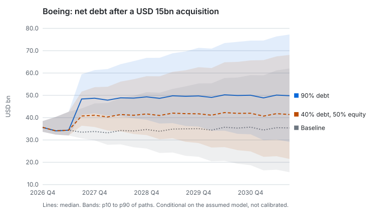
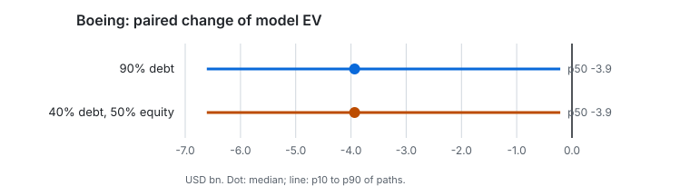

# Case study 2 — M&A stress and valuation: Boeing

**Evidence level: conditional simulation.** Paired Monte Carlo paths of a model of Boeing built from its SEC filings: conditional on that model, not calibrated, not market values and not a causal effect.

## Question

If Boeing bought a business for USD 15bn, how would the way it pays — mostly debt, or half equity — change its cash, debt, value and the chance of a funding shortfall?

## Method

| Part | What was used |
|---|---|
| Company and cutoff | The Boeing Company (CIK 12927), knowledge cutoff 2026-11-06, opening balance 2026-09-30 |
| Case | `case-12927-20261106` ([Stage 24b](../../stages/24b-real-companies.md)) |
| Target (an assumption, not a real deal) | Price USD 15bn, revenue USD 6bn a year, EBITDA margin 15%, deal costs 2%, integration costs 2–10% (mode 5%), cost synergies 0–6% (mode 3%), completion probability 90%, new debt at 6.5% |
| Financing | [`debt-financed.json`](decisions/debt-financed.json): 10% cash, 90% debt; [`equity-financed.json`](decisions/equity-financed.json): 10% cash, 40% debt, 50% new shares |
| Runs | 3 000 paired paths each, seed 20261107, five sensitivity variants on 1 000 paths |
| Reports | [`debt-financed/report.md`](debt-financed/report.md) (`rep-20261106-a32ba6b2eda7`), [`equity-financed/report.md`](equity-financed/report.md) (`rep-20261106-aa2c0d7cf295`) |

EBITDA flows to FCFF, FCFF to a model DCF, and every quarter of every path reconciles cash, debt and equity in the statement engine ([ADR-0029](../../adr/0029-financial-engine.md)).

## Results





| Quantity, USD bn or share of paths | Baseline | 90% debt | 40% debt, 50% equity |
|---|---|---|---|
| Model EV, median | 93.3 | 87.7 | 87.7 |
| Paired EV change, p10 / p50 / p90 | — | −6.6 / −3.9 / −0.2 | −6.6 / −3.9 / −0.2 |
| Funding shortfall | 34.3% | 39.4% | 37.1% |
| Cash below its minimum | 38.7% | 44.9% | 42.2% |
| Covenant breach in any quarter | 99.4% | 99.7% | 99.5% |

## Comparison

- **Enterprise value does not depend on the financing**, by construction: it discounts unlevered FCFF. Both runs give the same paired EV change, a median loss of USD 3.9bn: the price is above the model value of what is bought.
- **Financing moves cash and debt.** At the end of the horizon, 2031 Q3, median net debt is USD 49.9bn with 90% debt, USD 41.4bn with half equity and USD 35.4bn in the baseline, and the share of paths with a funding shortfall falls from 39.4% to 37.1%. Each share has a Monte Carlo error of about 0.9 points, so the gap is about two such errors: small, and not clearly resolved at 3 000 paths.
- **The covenant test says nothing here.** It breaks on 99.4% of baseline paths: Boeing's debt against its depressed EBITDA is beyond the assumed covenant level before any deal. The report of the debt-financed run flags that this probability had not settled at 1 000 paths.
- **Equity value is the same in both runs.** The model has no price per share (decision D-06), so the dilution of a share issue does not show as a loss to existing holders. That is a limit of the model, not a finding.

## What this does not show

- Whether any real acquisition by Boeing would be good. The target is invented to exercise the mechanics.
- Market reaction, ratings or the price of new debt, which stays at 6.5% in every path.

## Reproduce

```bash
python -m multiverse_simulation replay --manifest docs/case-studies/ma-stress/debt-financed/manifest.json --case var/data/cases/case-12927-20261106.json
```
