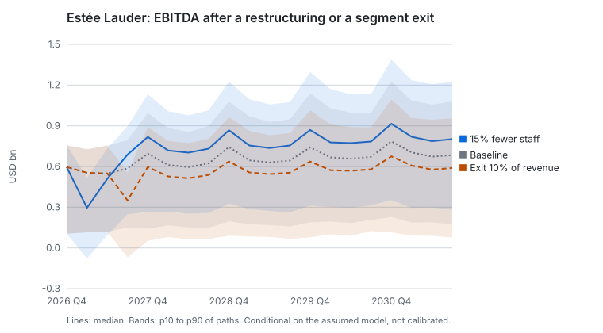
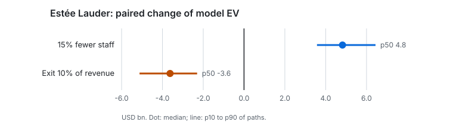

# Case study 3 — Operating restructuring or exit: Estée Lauder

**Evidence level: conditional simulation.** Paired Monte Carlo paths of a model of Estée Lauder built from its SEC filings: conditional on that model, not calibrated, not market values and not a causal effect.

## Question

Two ways to cut costs: 15% fewer staff, or leaving a low-margin segment with 10% of revenue. What does each cost at once, what does it save for good, and how bad can it get?

## Method

| Part | What was used |
|---|---|
| Company and cutoff | The Estée Lauder Companies (CIK 1001250), knowledge cutoff 2026-11-06, opening balance 2026-09-30 |
| Case | `case-1001250-20261106` ([Stage 24b](../../stages/24b-real-companies.md)) |
| Restructuring | [`restructure.json`](decisions/restructure.json): −15% headcount, payroll assumed at 25% of revenue, one-off cost of 2–8 months of pay (mode 4), 50–90% of savings realised (mode 70%), productivity loss 0–10% (mode 3%) |
| Exit | [`exit-segment.json`](decisions/exit-segment.json): a segment with 10% of revenue and a 5% EBITDA margin, closed with no proceeds, separation cost 3%, stranded costs 10–40% of its costs (mode 25%) |
| Runs | 3 000 paired paths each, seed 20261107, five sensitivity variants on 1 000 paths |
| Reports | [`restructure/report.md`](restructure/report.md) (`rep-20261106-82767eb1bea7`), [`exit-segment/report.md`](exit-segment/report.md) (`rep-20261106-d123799aaff8`) |

The payroll share, the segment and its margin are assumptions: the filings in the warehouse give neither headcount nor segment results.

## Results





| Quantity, USD bn or share of paths | Baseline | 15% fewer staff | Exit 10% of revenue |
|---|---|---|---|
| Model EV, median | 23.4 | 27.9 | 20.0 |
| Paired EV change, p10 / p50 / p90 | — | 3.6 / 4.8 / 6.4 | −5.1 / −3.6 / −2.3 |
| Covenant breach in any quarter | 56.3% | 48.1% | 68.3% |
| Negative operating FCFF four quarters in a row | 25.5% | 15.0% | 34.1% |
| Funding shortfall | 0.0% | 0.0% | 0.0% |

## Comparison

- **One-off cost against lasting saving.** The restructuring pays a few months of pay at once and saves part of the payroll for good: on the median path the saving outweighs the cost by USD 4.8bn of model value, and the p10 path still gains USD 3.6bn.
- **The exit loses value in this model** because stranded costs stay behind: the segment's 5% margin goes, a quarter of its costs does not, and there are no proceeds. Covenant breaches rise from 56% to 68% of paths.
- **Execution risk is in the ranges**, not in a single number: savings realisation, one-off cost and productivity loss are drawn on every path. With shocks 25% larger, the covenant breach of the restructuring rises from 47.1% to 57.5% (1 000 paths), the largest move of any variant.

## What this does not show

- That 15% fewer staff is feasible, or what it would do to sales beyond the assumed productivity loss of 0–10%.
- Which segment Estée Lauder could leave: the segment here is invented.

## Reproduce

```bash
python -m multiverse_simulation replay --manifest docs/case-studies/restructuring-exit/restructure/manifest.json --case var/data/case-studies/cases/case-1001250-20261106.json
```
