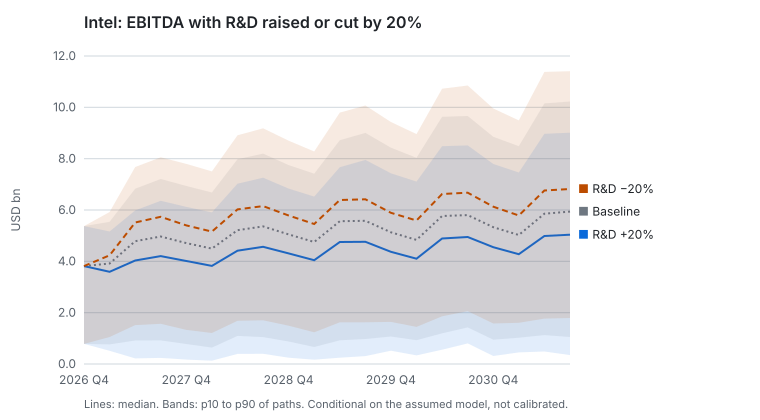
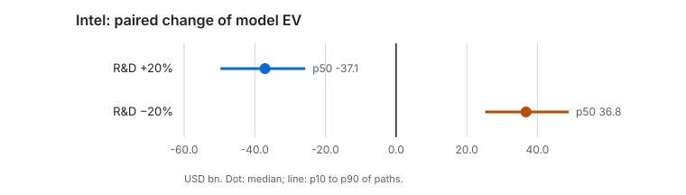

# Case study 1 — R&D allocation under uncertainty: Intel

**Evidence level: conditional simulation.** The numbers below come from paired Monte Carlo paths of a model of Intel built from its SEC filings. They are conditional on that model, not calibrated, not market values and not a causal effect.

## Question

What would raising or cutting Intel's R&D budget by 20% do to its cash flows, risks and model value over five years, against the same company without the change, under the same shocks?

## Method

| Part | What was used |
|---|---|
| Company and cutoff | Intel Corp (CIK 50863), knowledge cutoff 2026-11-06, opening balance 2026-09-30 |
| Case | `case-50863-20261106`: 8 reported quarters from 4 filings, 67 quarters of shock history from 573 firms of the same SIC division ([Stage 24b](../../stages/24b-real-companies.md)) |
| Decisions | [`rnd-up.json`](decisions/rnd-up.json): R&D +20% of the previous budget; [`rnd-down.json`](decisions/rnd-down.json): −20%. Announced 2026-12-01, effective 2027-01-01, ramp of 2 quarters, paid in cash |
| Engine | Statement engine ([ADR-0029](../../adr/0029-financial-engine.md)) and paired Monte Carlo ([ADR-0030](../../adr/0030-paired-monte-carlo.md)) |
| Runs | 3 000 paired paths each, seed 20261107, five sensitivity variants of the shock model on 1 000 paths |
| Reports | [`rnd-up/report.md`](rnd-up/report.md) (`rep-20261106-f02fdd6e65ff`), [`rnd-down/report.md`](rnd-down/report.md) (`rep-20261106-afb12b1dc942`), each with CSV, document and manifest |

The lagged hypothesis — that R&D spending today raises revenue later — is the heart of this question, and it is not in the numbers. The engine has a parameter for revenue per unit of extra R&D after the adoption delay, and it is zero unless someone has a reason. The causal feasibility study of [Stage 20](../../stages/20-causal-research-pipeline.md) found no method and decision pair that the data could support, so no such reason exists here. What the runs show is the cost side of R&D, nothing else.

## Results





| Quantity, USD bn or share of paths | Baseline | R&D +20% | R&D −20% |
|---|---|---|---|
| Model EV, median | 57.1 | 30.8 | 85.7 |
| Paired EV change, p10 / p50 / p90 | — | −49.7 / −37.1 / −25.7 | 25.2 / 36.8 / 48.8 |
| Covenant breach in any quarter | 58.2% | 68.5% | 48.8% |
| Funding shortfall | 24.6% | 42.4% | 13.5% |
| Negative operating FCFF four quarters in a row | 85.6% | 96.3% | 72.9% |
| Enterprise value undefined | 30.7% of paths | 47.5% | 21.1% |

Monte Carlo errors of the shares are below one percentage point (see the risk tables of each report).

## Comparison and sensitivity

- The two decisions are nearly mirror images: about USD 37bn of model value either way. With a zero revenue return, the change of value is the present value of the extra or saved spending, so this symmetry is what the model must give.
- Intel's baseline is already strained in this model: a covenant breach on 58% of paths and negative operating FCFF over a year on 86%. Extra R&D paid in cash raises the funding shortfall from 25% to 42% of paths.
- None of the five sensitivity variants moves the median EV change by more than USD 1.4bn. Shocks 25% larger raise the covenant breach of R&D +20% from 69.4% to 71.2% (1 000 paths each).

## What this does not show

- Whether Intel's R&D pays back. That needs an estimate of the return on R&D, which this project does not have: the outcome cannot be read as advice to cut R&D.
- The value of a company in distress: enterprise value is undefined on 21% to 48% of paths, where the model DCF has no finite value.
- Anything about confounding: there is no estimate to be confounded. A study of R&D would first need events with known timing and a design that separates them from the reasons a firm changes R&D.

## Reproduce

```bash
python -m multiverse_simulation replay --manifest docs/case-studies/rnd-allocation/rnd-up/manifest.json --case var/data/cases/case-50863-20261106.json
```

On 2026-11-07 this rebuilt all three files of `rep-20261106-f02fdd6e65ff` byte for byte in 63 s. The case lives in `var/`, built by `python -m multiverse_simulation companies` ([Stage 24b](../../stages/24b-real-companies.md)).
