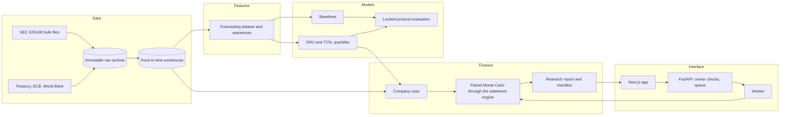

# MULTIVERSE — portfolio case study

*A counterfactual financial scenario platform with point-in-time corporate data, temporal forecasting and probabilistic valuation.*

Every number on this page was measured in this repository and links to the report that measured it. Nothing here is a user count, a return on investment or an accuracy claim beyond those reports.

## Problem

Strategy asks "what if": what if this company raised R&D, bought a competitor, cut staff? Planning spreadsheets answer with one line per scenario and hide where the inputs came from, what was known at the time and how uncertain the answer is. A research tool for such questions has to keep three things apart that are easy to blur: what the filings say, what a model forecasts, and what a decision would cause.

## Approach

1. **Official sources, point in time.** SEC XBRL company facts and filings, Treasury, ECB and World Bank series, each value stored with the moment it became public ([Stage 12](../stages/12-point-in-time-warehouse.md), [Stage 13](../stages/13-macro-vintages.md)). A snapshot at any cutoff holds only what was public then; a leakage check proves it.
2. **Baselines before networks.** Seven simple forecasters under a protocol locked before scoring ([Stage 15](../stages/15-baseline-forecasting.md)), then a GRU with attention and a temporal convolutional network on the same rows ([Stage 16](../stages/16-temporal-neural-net.md)), then quantiles and calibration on years never used for a choice ([Stage 17](../stages/17-probabilistic-validation.md)).
3. **Causality is asked, not assumed.** A feasibility study measures what the data could identify before any effect is estimated ([Stage 20](../stages/20-causal-research-pipeline.md)).
4. **Accounting that reconciles.** A decision becomes entries in three statements that balance every quarter, then FCFF and a model DCF ([Stage 21](../stages/21-financial-statement-engine.md)); paired Monte Carlo runs the company with and without the decision on the same shocks ([Stage 22](../stages/22-paired-monte-carlo.md)).
5. **Reports that can be audited and replayed** ([Stage 25](../stages/25-reports-portfolio.md), [ADR-0034](../adr/0034-report-studio.md)).

## Architecture

Python packages for contracts, pipelines, forecasting, causal diagnostics, finance and simulation; a job queue and worker that survive a closed browser; a FastAPI service that records and serves but never computes; a Next.js app. Contracts are Pydantic models exported to JSON Schema and TypeScript, so both sides check the same shapes. Decisions are recorded in 34 ADRs ([index](../adr/README.md)).

## Real evaluated performance

| What | Measured | Where |
|---|---|---|
| Dataset audit, 1 000 companies | 17 508 usable examples from 786 companies at 12 quarters of history and a 4-quarter horizon; leakage proof passed; 10 manual reconciliations with filings | [Stage 14b](../stages/14b-data-acquisition.md) |
| Baselines | They beat persistence on revenue growth; for margins of firms with material revenue none of the seven does | [Stage 15](../stages/15-baseline-forecasting.md) |
| Temporal network, first universe | MAE below persistence on 25 of 25 target and horizon pairs, below the best baseline on 24 | [Stage 16](../stages/16-temporal-neural-net.md) |
| Quantiles, first universe | 3 of 15 pairs pass an approval rule written before scoring; coverage worse in 2020 | [Stage 17](../stages/17-probabilistic-validation.md) |
| Model without FRED, 1 429 companies | Revenue growth over 4 quarters: MAE 31.7% below persistence (29.9 to 33.4%), 4.7% below the best baseline; over 1 quarter 11.8% worse than gradient boosting | [Stage 24b](../stages/24b-real-companies.md) |
| Its p10 to p90 ranges, 2024 to 2026 | Held 82.2% of outcomes for revenue growth over 4 quarters, 85.2% for EBITDA margin, against 80% stated; 2 of 15 pairs pass the approval rule | [Stage 24b](../stages/24b-real-companies.md) |
| Training time | 150 trainings in 63.4 minutes and a quantile evaluation in 52.7 minutes on one RTX 4070 Laptop GPU | [Stage 24b](../stages/24b-real-companies.md) |
| Report replay | A real report rebuilt from its manifest byte for byte, in 63 s | [Stage 25](../stages/25-reports-portfolio.md) |

These are results on held-out years of one universe and one cutoff. They are not product accuracy, and no model here is approved for decisions.

## Failure analysis

- **No causal effect could be estimated.** The feasibility study found none of 24 pairs of method and decision feasible: too few events with clean timing in the 60 filings read by hand ([Stage 19](../stages/19-corporate-event-ontology.md), [Stage 20](../stages/20-causal-research-pipeline.md)). Every scenario is therefore conditional mechanics, and says so.
- **Margins are hard.** Neither the baselines nor the networks beat persistence on the median error of margins by much, and most margin pairs fail the approval rule.
- **A licence problem found late.** The FRED terms forbid machine learning on FRED content; the first models were trained on seven FRED series. New training on them is refused in code, and the forecasts on screen come from a model trained without FRED ([Stage 24](../stages/24-security-privacy-governance.md)).
- **What the case studies exposed.** R&D has no estimated return, so raising it can only cost value in the model; financing does not change an unlevered enterprise value, and without a price per share the dilution of a share issue does not show ([case studies](../case-studies/README.md)).
- **Coverage gaps.** Companies without a 10-K (Saudi Aramco, Samsung, TSMC) are not in the universe; banks and insurers have no simulation case.

## Reproducibility

- Raw files are immutable and hashed; warehouse snapshots, datasets, models and runs are named by content hashes.
- Forecasting protocols are files written before scoring, and their hashes go into each evaluation package.
- A simulation report hashes its case, decision, settings and engine versions; a research report hashes that identity; its manifest records the SHA-256 of every file and replays them.
- `npm run check` runs the whole gate: lint, strict types, module boundaries, 1 093 Python tests, 300 TypeScript unit tests and 726 browser tests at three screen sizes with an accessibility scan (Stage 25 gate).

## Security

The API serves the loopback only by default or checks Bearer tokens with roles, owns every object, enforces spending and compute limits in the queue, and audits access without storing addresses. A threat model, a register of 36 issues and a licence inventory are in [`docs/security`](../security/README.md).

## Learnings

1. A simple model often wins: the baselines set the bar the networks had to clear, and on short horizons gradient boosting still wins.
2. Point-in-time data is most of the work: revised filings, fiscal calendars, scale errors and fee tables each broke an assumption.
3. Saying "not estimated" is a result. The causal study's zero is what keeps the scenarios honest.
4. Licence terms are data too, and need the same review as the numbers.

## More

- [Case studies](../case-studies/README.md) · [Interview questions](interview-questions.md) · [Resume bullets](resume-bullets.md) · [Demo script](demo-script.md) · [Screenshots](screens/)
