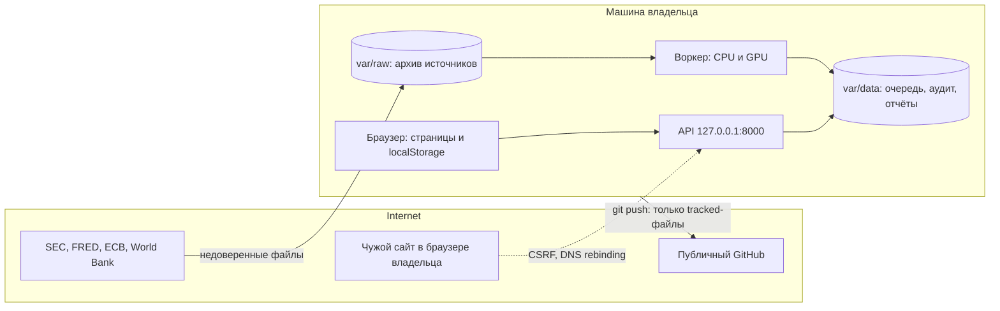

# Модель угроз MULTIVERSE

| Поле | Значение |
|---|---|
| Этап | 24 — security, privacy, licences |
| Дата | 2026-11-06 |
| Основание | `docs/12_SECURITY_AND_GOVERNANCE.md` комплекта, промпт 24 |
| Что проверено | Код на коммите Stage 23 и его изменения этого этапа, живые атаки на собственный API на `127.0.0.1` |
| Что не проверено | Внешние системы. Ни одной атаки на GitHub, SEC, FRED, ECB, World Bank |

## Что сейчас есть на самом деле

Модель угроз описывает систему такой, какая она есть, а не какой станет.

- **Нет публичного развёртывания.** Сайт и API работают только на машине владельца. Публикация — отдельное решение (OQ-07).
- **Нет аккаунтов пользователей** (D-07). Заметки, сценарии и рецензии лежат в `localStorage` браузера.
- **Публичен только репозиторий** `tabwwwq/MULTIVERSE`. В него попадает всё, что закоммичено, навсегда: история не переписывается.
- **Есть один локальный API** на `127.0.0.1:8000` и воркер. API принимает задания и читает их состояние, но ничего не считает.
- **В коде нет обращений к LLM.** Текст отчётов SEC разбирается стандартным `html.parser`, а не моделью.

## Границы доверия

Главная граница, которую легко не заметить: **браузер владельца открывает чужие сайты**. Любая такая страница может послать запрос на `127.0.0.1`. Поэтому «API слушает только loopback» — не защита.

## Активы

| Актив | Где лежит | Что будет при потере |
|---|---|---|
| Ключ FRED, контактный email в User-Agent SEC | `.env`, не в git | Отзыв ключа, блокировка доступа |
| Бюджет вычислений: GPU, облачные расходы | Очередь заданий | Прямые деньги, если облако включат |
| Очередь, аудит, отчёты симуляций | `var/data/jobs`, `var/data/simulations` | Потеря результатов, которых нельзя пересобрать |
| Чекпоинты моделей | `var/data/jobs/<id>`, `var/data/forecast` | Выполнение кода при загрузке подменённого файла |
| Архив источников | `var/raw` | Нарушение условий при публикации |
| Сценарии и заметки пользователя | `localStorage` браузера | Раскрытие частных параметров |
| Токены API | `.env` как SHA-256, сам токен у владельца | Действия от чужого имени |
| Workflow и зависимости | `.github`, `uv.lock`, `package-lock.json` | Подмена кода в цепочке поставки |

## Противники и что они делают

| Противник | Цель | Как достаёт | Контроль | Проверка |
|---|---|---|---|---|
| Чужой сайт в браузере | Запустить или одобрить задание | CSRF `text/plain` без preflight | `Guard`: Origin, Sec-Fetch-Site, только `application/json` | `test_a_page_of_another_site_cannot_post`, `test_a_simple_form_post_is_refused` |
| Чужой сайт через DNS rebinding | Читать ответы API как своего хоста | Подмена DNS, запрос с чужим `Host` | `Guard`: список разрешённых имён | `test_a_stranger_host_is_turned_away` |
| Анонимный посетитель сети | Читать и менять задания | Прямые запросы, если API откроют наружу | `local` режим запрещён вне loopback и в production, в `token` режиме нужен токен | `test_settings_never_serve_without_tokens_off_the_loopback`, `test_no_route_answers_without_a_token` |
| Скомпрометированный аккаунт | Чужие объекты | Перебор `job_id` | Проверка владельца, чужое отвечает 404 как несуществующее | `test_someone_elses_job_does_not_exist`, `test_someone_elses_report_does_not_exist` |
| Оператор без права расхода | Запустить дорогую работу | Самоодобрение | Одобряет только `admin`, имя берётся из токена | `test_only_an_admin_approves`, `test_an_approval_cannot_borrow_a_name` |
| Бот, сжигающий вычисления | Деньги и GPU | Поток заданий | Лимиты: ставка запросов, активные задания, секунды в сутки, общий лимит расходов | `test_a_flood_of_jobs_stops_at_the_limit_of_active_jobs`, `test_paid_compute_is_off_by_default` |
| Подбор токена | Вход | Перебор | 10 ошибок в минуту на адрес, токен 256 бит, сравнение постоянного времени | `test_guessing_tokens_stops_after_a_few_tries` |
| Вредоносный чекпоинт | Выполнить код | Подмена `.pt` или `.npz` | `weights_only=True`, `allow_pickle=False`, проверка SHA-256 до чтения | `test_a_hostile_checkpoint_never_runs`, `test_a_hostile_frame_never_runs` |
| Вредоносный документ источника | Инъекция в разбор или в рецензента | Текст отчёта, HTML | Хосты только официальные, разбор без внешних сущностей, текст в UI экранирован React | `test_untrusted_filing_text_stays_text`, e2e `stays text` |
| Инъекция промпта в отчёте | Заставить ИИ-рецензента исказить событие | Текст 8-K | Текст — данные. Событие требует ссылку на отчёт, аудит Stage 19 считает реестр недостоверным, ничего не действует автоматически | Правило `event-annotation-guidelines.md`, вердикт аудита |
| Подмена файла задания | Прочитать файл машины | `protocol_path=../../.env` | Шаблон в контракте и проверка в воркере | `test_a_path_outside_the_protocols_is_a_422`, `test_a_stored_path_cannot_leave_the_protocols` |
| Экспорт в электронную таблицу | Выполнить формулу у получателя | Название, начинающееся с `=` | `csvCell` превращает формулу в текст, числа не трогает | `spreadsheet formulas in exported files` |
| Цепочка поставки | Подмена кода CI | Сдвиг тега action | SHA в `ci.yml`, `--locked`, аудит зависимостей | Job `Dependency audit`, job `Secret scan` |
| Случайная публикация | Ключ или сырые данные в git | `git add` | `.gitignore`, тест секретов, тест упаковки, gitleaks | `tests/smoke/test_no_secrets.py`, `tests/smoke/test_packaging.py` |

## Что осталось принятым риском

- **Локальный процесс владельца доверен.** В режиме `local` любая программа этого пользователя может вызвать API. Она и так читает `var/`, поэтому токен не добавил бы защиты.
- **CSP разрешает inline-скрипты.** Next.js пишет их в статические страницы. Защита от внедрённой разметки держится на отсутствии HTML-приёмников в коде, это проверяет тест.
- **Аудит можно изменить,** имея доступ к файлу. Он отвечает на вопрос «кто что делал», а не защищает от владельца машины.
- **Лимитер живёт в памяти одного процесса.** Рестарт его обнуляет, несколько процессов считали бы раздельно.

## Условия для публичного развёртывания

Сейчас это не нужно. Перед Stage 26, если владелец решит публиковать, обязательны:

1. TLS на обратном прокси и `MULTIVERSE_AUTH_MODE=token`.
2. OIDC или другой вход для браузера. Сейчас веб-страницы умеют работать только с `local` API.
3. Лимитер и аудит вне процесса.
4. Обновление `api_allowed_hosts`, `web_origins` и CSP под настоящий домен.
5. Закрытые решения по [реестру лицензий](license-inventory.md).

Связанные документы: [реестр проблем](issue-register.md), [инвентаризация данных](gdpr-data-inventory.md), [ADR-0032](../adr/0032-security-boundary.md).
